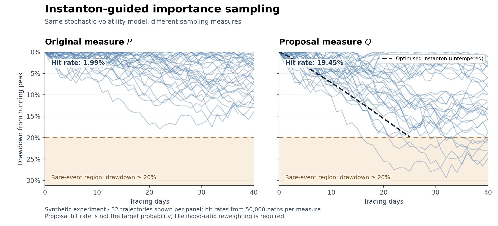

# Instanton-Guided Importance Sampling for Rare Financial Events

A computational investigation of rare, path-dependent financial events using **instanton (minimum-action) paths**, **stochastic-volatility models**, and **importance sampling**.

This project explores the application of large-deviation methods from mathematical physics to financial risk modelling. Rather than relying exclusively on conventional Monte Carlo simulation, it constructs importance-sampling proposals using optimised trajectories that lead towards rare drawdown events.

This repository implements an end-to-end Python pipeline that:

- builds a daily market state from SPY prices,
- fits a 2D Markov stochastic-volatility (SV) diffusion on a matched daily discretisation,
- computes fixed-time instantons for finite-horizon drawdown-threshold hitting events,
- constructs instanton-guided importance-sampling proposals with Gaussian-shift likelihood ratios,
- estimates model-implied drawdown probabilities together with Monte Carlo uncertainty diagnostics,
- examines numerical reliability through effective sample sizes, importance-weight statistics, and optional conventional Monte Carlo comparisons.

> [!IMPORTANT]
> This repository is a methodological and computational research project, not a validated market crash prediction system.
>
> The historical SPY experiments and associated figures are retained as illustrations of the numerical framework. They should not be interpreted as representative evidence of prospective crash prediction, trading performance, or reliable real-world crash probabilities.
>
> In particular, the original drawdown definition includes events that may already have occurred at the forecast origin, which can make the historical results appear more predictive than they actually are.

---

## Why this repository exists

Extreme financial events are difficult to estimate using standard simulation because the events of interest are rare and path-dependent. Conventional Monte Carlo may require a large number of simulated trajectories to obtain sufficiently many observations of a rare event.

In volatility-based financial models, it is also possible to capture clustering in variance without correctly representing the structure of the far tail.

This project explores a different computational viewpoint inspired by mathematical physics: instead of treating a crash as simply a very large return, it treats an extreme drawdown as a **rare trajectory of a stochastic system**.

The practical idea is:

1. Define a finite-horizon drawdown event on a daily grid.
2. Numerically compute a **minimum-action path** that reaches that event.
3. Use that path to construct a proposal distribution favouring crash-like trajectories.
4. Estimate the event probability under the original stochastic model through likelihood-ratio reweighting.

The instanton is therefore **not** used as a closed-form crash probability formula. It is used as a principled proposal mechanism for rare-event Monte Carlo.

### Synthetic illustration of the sampling mechanism



Both panels use the same daily discretisation, initial state and stochastic-volatility parameters. The left panel samples under the original model measure $P$; the right panel samples under the instanton-guided proposal $Q$. The dashed black line is the untempered numerically optimised instanton, which reaches the target up to the optimiser's exact-drawdown tolerance. The simulated proposal uses a tempered and capped control. Drawdowns are measured from each trajectory's running peak.

In this synthetic example, the drawdown hit rate increases from 1.988% under $P$ to 19.456% under $Q$ (50,000 paths per measure). After likelihood-ratio reweighting, the estimated target probabilities are 1.988% and approximately 1.902%, respectively. The Monte Carlo standard errors are approximately 0.0624 and 0.0319 percentage points. These are illustrative results from a single configuration, not a comprehensive variance-reduction or runtime benchmark, and not a market forecast.

Reproduce the figure without market data:

```bash
python scripts/05_plot_sampling_demo.py
```

### Mathematical motivation

The methodology draws on ideas from:

- Large-deviation theory.
- Stochastic differential equations.
- Calculus of variations.
- Minimum-action methods.
- Numerical constrained optimisation.
- Change of probability measure.
- Importance sampling.

In the small-noise setting, large-deviation theory relates the probability of rare trajectories to an action functional. Minimum-action paths identify trajectories that minimise this functional subject to a specified event constraint.

The project investigates how this mathematical structure can be used to guide numerical simulation towards trajectories that would otherwise be infrequently observed.

### Sampling efficiency versus predictive accuracy

A central distinction in this project is between the numerical estimation of a model-implied probability and the empirical validity of that probability.

Let $P_\theta$ denote the original stochastic model, with parameters $\theta$, and let $A$ denote a rare event.

The target quantity is

$$
p_\theta = P_\theta(A).
$$

Let $Q$ denote an instanton-guided proposal distribution. The corresponding importance-sampling estimator is

$$
\hat p_{\mathrm{IS}}
=
\frac{1}{N}
\sum_{i=1}^{N}
\mathbf{1}_A(X^{(i)})
\frac{dP_\theta}{dQ}(X^{(i)}),
\qquad
X^{(i)} \sim Q.
$$

Provided the likelihood ratios are correctly specified and the proposal satisfies the necessary support conditions, conventional Monte Carlo and instanton-guided importance sampling estimate the same underlying model probability.

The potential advantage of the instanton approach is computational: it concentrates simulation effort on rare trajectories of interest.

It does not introduce additional information about future market behaviour.

If $p_{\mathrm{true}}$ denotes the unknown real-world event probability, the total estimation error can be decomposed as

$$
\hat p_{\mathrm{IS}} - p_{\mathrm{true}}
=
\underbrace{
\hat p_{\mathrm{IS}} - p_\theta
}_{\text{Monte Carlo estimation error}}
+
\underbrace{
p_\theta - p_{\mathrm{true}}
}_{\text{Model error}}.
$$

Importance sampling addresses the first term by changing how trajectories are generated. It does not resolve the second term, which depends on the suitability of the stochastic model, its estimated parameters, and its ability to represent future market dynamics.

A more precise numerical estimate of a misspecified model does not necessarily produce a more accurate financial prediction.

---

## Model-implied drawdown event

Let $P_k$ be the daily adjusted close and $X_k = \log P_k$.

Define the running peak and drawdown on the daily grid by

- $M_k = \max_{j \le k} X_j$,
- $D_k = M_k - X_k \ge 0$ (log-drawdown),
- $\delta_k = 1 - e^{-D_k}$ (drawdown fraction).

For a chosen drawdown fraction $\delta \in (0,1)$, define the corresponding log-threshold

$$
d(\delta) = -\log(1-\delta).
$$

Given simulation origin day $k$, current state

$$
(X_k,V_k,D_k)=(x_0,v_0,d_0),
$$

and a horizon of $T_{\text{days}}=n$ trading days, the quantity estimated under the fitted stochastic model is

$$
p_k(T_{\text{days}},\delta)
=
\mathbb{P}_{\theta}\left(
\max_{0\le i\le n} D_{k+i}
\ge d(\delta)
\;\middle|\;
X_k=x_0,\;
V_k=v_0,\;
D_k=d_0
\right).
$$

### Important modelling convention

$(X,V)$ are simulated as a **2D Markov diffusion**.

Drawdown $D$ is **not** a third stochastic differential equation. It is updated deterministically from the simulated $X$-path using the exact running-maximum recursion.

### The already-hit regime

Under the event definition above, if

$$
d_0 \ge d(\delta),
$$

then the event is already satisfied at the simulation origin.

In that case the estimated probability is deterministically

- $\hat p=1$,
- $\mathrm{SE}=0$,

and no instanton or importance-sampling run is needed.

### Interpretation and limitations of the event definition

The event is defined relative to the historical running maximum and explicitly includes the initial observation at the simulation origin.

Consequently, if the current drawdown already exceeds the specified threshold, the event probability is one by construction.

This is a consequence of the mathematical event definition rather than a successful prediction of a future crash.

Even when the threshold has not yet been breached, an existing drawdown may place the market close to the threshold. Estimating the probability of crossing that threshold is therefore substantially different from predicting a new decline from current market levels.

For example, if the market is already 19% below its historical peak, estimating the probability of reaching a 20% drawdown does not amount to estimating the probability of a new 20% market decline.

The original historical evaluation therefore mixes:

- non-trivial future threshold-hitting events,
- events that are already satisfied at the initial observation,
- events where the market is already close to the specified threshold.

Although this definition is internally consistent for demonstrating the sampling framework, it is not an appropriate standalone target for assessing prospective crash prediction.

The original event definition is retained for reproducibility of the computational study.

A future forecasting-oriented investigation could instead consider losses relative to the current price or maximum drawdowns defined entirely within the forward simulation window. Such a change would require corresponding modifications to the optimisation, simulation, and evaluation procedures.

---

## Method at a glance

The implementation follows this logic.

### 1. Daily state construction

From SPY daily adjusted-close data, build a daily state table containing:

- Price.
- Log-price.
- Returns.
- Running peak.
- Log-drawdown.
- Drawdown fraction.
- Rolling realised-variance proxy.

### 2. Stochastic-volatility fit

Fit a 2D Markov stochastic-volatility model for $(X,V)$ on the same daily grid used later in simulation and optimisation.

The fitted diffusion provides the underlying stochastic dynamics from which model-implied event probabilities are estimated.

The model specification is treated as an input to the rare-event simulation framework, rather than as a validated description of financial market dynamics.

### 3. Finite-horizon drawdown event

For each simulation origin and query $(T_{\text{days}},\delta)$, define the event that the running drawdown reaches or exceeds the specified threshold within the simulation horizon, including the initial observation.

### 4. Instanton computation

For each candidate hitting day $\tau \le n$, numerically solve a discrete minimum-action problem for a path that reaches the drawdown constraint at that time.

Select the lowest-action candidate over $\tau$.

Schematically, the optimisation problem takes the form

$$
x^\star
\approx
\operatorname*{arg\,min}_{x\in\mathcal{A}}
S[x],
$$

where $S[x]$ is the discretised action functional and $\mathcal{A}$ denotes the relevant constrained path space.

The numerical optimiser uses a smooth approximation to the running-maximum constraint. Exact drawdown quantities are subsequently used to examine the resulting path.

The computed instanton is interpreted as a numerically optimised rare-event trajectory, not as a deterministic prediction of the path the market will follow.

### 5. Instanton-guided proposal

Convert the selected minimum-action path into a control drift $u^\star$.

Apply a tempered and capped version of this control in simulation to generate rare-event trajectories more frequently under a proposal measure $Q$.

The control modifies the sampling distribution without changing the underlying target probability that the estimator is intended to recover.

### 6. Likelihood-ratio reweighting

Estimate the event probability under the original measure $P$ using the pathwise likelihood ratio corresponding to a Gaussian shift of the independent Brownian increments.

Although the Gaussian-shift likelihood-ratio expression is exact for the specified discretised simulation scheme, the resulting finite-sample probability estimate remains subject to Monte Carlo uncertainty.

The numerical effectiveness of the estimator depends on the quality of the proposal distribution and the behaviour of the importance weights.

### 7. Numerical diagnostics and exploratory evaluation

Examine the numerical behaviour of the sampling framework using:

- Monte Carlo standard errors.
- Effective sample sizes.
- Importance-weight statistics.
- Proposal-measure event hit rates.
- Minimum-action optimisation diagnostics.
- Event-set ordering checks.
- Optional conventional Monte Carlo comparisons.

The original implementation also provides historical event labels, scoring rules, calibration summaries, and probability time series.

These historical evaluation tools are retained for transparency and reproducibility, but their outputs should be interpreted as exploratory diagnostics rather than validated evidence of financial forecasting performance.

---

## Main modelling conventions

Implemented in `src/constants.py`, `src/model_sv.py`, and used throughout optimisation and simulation:

- **Daily grid:** $\Delta t=1/252$ years.

- **Default query grid:** $\delta\in\{0.20,0.30\}$ and $T_{\text{days}}\in\{20,60\}$.

- **Threshold transform:**

  $$
  d(\delta)=-\log(1-\delta).
  $$

- **Drawdown update:** exact running maximum in simulation and evaluation; smooth surrogate only inside the optimiser.

- **Effective variance regularisation:**

  $$
  v_{\text{eff}}
  =
  v_{\min}
  +
  \mathrm{softplus}_{\alpha_v}(v-v_{\min}),
  $$

  used in the coefficients, action, and simulation.

- **Importance-sampling control:**

  $$
  u_i=\mathrm{cap}(\lambda u_i^\star),
  $$

  with post-hit truncation.

- **Likelihood ratio:** Gaussian-shift likelihood ratio on independent Brownian increments under the discretised simulation scheme.

---

## Repository layout

```text
instanton-importance-sampling/
├─ data/
│  ├─ raw/                       # fetched SPY adjusted-close data
│  └─ processed/                 # state table: X, r, M, D, delta, V_proxy, ...
│
├─ src/
│  ├─ constants.py               # daily grid, query grid, regularisation + IS knobs
│  ├─ data_state.py              # Step 1: state construction
│  ├─ fit.py                     # Step 2: QMLE-style fit for (µ, κ, v̄, ξ, ρ)
│  ├─ model_sv.py                # variance regularisation
│  ├─ instanton.py               # fixed-time MAM, τ-search, instanton -> control
│  ├─ importance_sampling.py     # IS simulation, LR, estimator, ESS
│  ├─ evaluation.py              # labels, scores, reliability, naive MC helpers
│  ├─ plotting.py                # shared plot helpers
│  └─ io.py                      # save/load helpers, metadata, instanton caching
│
├─ scripts/
│  ├─ 00_fetch_data.py
│  ├─ 01_build_state.py
│  ├─ 02_fit_model.py
│  ├─ 03_daily_forecast.py       # daily instanton + IS probability estimation
│  └─ 04_run_evaluation.py       # numerical diagnostics and historical figures
│
├─ outputs/
│  ├─ params/                    # fitted parameter snapshots
│  └─ runs/                      # per-run simulation/evaluation outputs
│
├─ tests/
└─ README.md
```

The original filenames and internal naming conventions are retained for compatibility and reproducibility.

In particular, the term `forecast` in script names and output fields refers to the original implementation and should not be interpreted as a claim of validated predictive performance.

---

## Illustrative numerical experiments

The repository includes a historical demonstration using **SPY during the 2007–2008 financial crisis**.

This period provides an example of substantial realised market drawdowns through which the numerical framework can be illustrated.

The stochastic-volatility model is fitted using pre-2007 observations.

### Experimental configuration

Default historical evaluation window:

- **Start:** 2007-01-01.
- **End:** 2008-10-31.

Default simulation queries:

- $T_{\text{days}}\in\{20,60\}$.
- $\delta\in\{0.20,0.30\}$.

This gives four fixed event configurations:

- 20 trading days, 20% drawdown.
- 20 trading days, 30% drawdown.
- 60 trading days, 20% drawdown.
- 60 trading days, 30% drawdown.

In the reported run, each non-trivial date-query pair used:

- $N=5000$ importance-sampling paths.
- Tempering parameter $\lambda=0.5$.
- Control norm cap $u_{\max}=10$.

The purpose of these experiments is to illustrate the operation of the computational pipeline, including minimum-action optimisation, controlled trajectory simulation, and probability estimation through likelihood-ratio reweighting.

### Numerical diagnostics from the original demonstration

| Query | Median ESS | Mean relative SE | Mean weight |
|---|---:|---:|---:|
| 20 days, 20% drawdown | 710 | 0.116 | 0.999 |
| 20 days, 30% drawdown | 81 | 0.193 | 0.997 |
| 60 days, 20% drawdown | 2247 | 0.072 | 1.002 |
| 60 days, 30% drawdown | 601 | 0.134 | 1.007 |

These values are retained from the original numerical demonstration.

Effective sample size (ESS) provides a diagnostic of importance-weight concentration:

$$
\mathrm{ESS}
=
\frac{
\left(\sum_{i=1}^{N}w_i\right)^2
}{
\sum_{i=1}^{N}w_i^2
},
$$

where

$$
w_i=\frac{dP}{dQ}(X^{(i)}).
$$

The results show considerable variation in the numerical behaviour of the importance sampler across different event configurations.

For example, the 20-day, 30% drawdown configuration produces a median effective sample size of approximately 81 out of 5,000 simulated paths, indicating substantial importance-weight degeneracy.

Mean importance weights close to one provide a useful numerical sanity check, but do not by themselves establish estimator accuracy, adequate tail coverage, or low variance.

Similarly, effective sample size based on the importance weights is a general diagnostic and does not directly measure the precision of the rare-event probability estimator.

Relative standard errors also require careful interpretation when probability estimates are extremely small or zero.

No systematic claim of computational superiority over conventional Monte Carlo is made, as a comprehensive comparison at matched computational cost has not been completed.

### Event-set ordering

The event definitions imply the following theoretical probability relationships:

$$
p_k(60,\delta)\ge p_k(20,\delta),
$$

and

$$
p_k(n,0.20)\ge p_k(n,0.30).
$$

Longer simulation horizons contain the corresponding shorter-horizon event sets, while milder drawdown thresholds contain the corresponding more extreme events.

The original numerical demonstration reported consistency with these ordering relationships across the evaluated sample.

These checks provide useful internal consistency diagnostics. However, they do not establish empirical forecasting validity.

### Interpretation of the historical figures

> [!WARNING]
> The historical probability time series, reliability diagrams, calibration statistics, and scoring-rule outputs are exploratory.
>
> Their appearance is influenced by the original historical-peak drawdown definition, already-breached thresholds, proximity to those thresholds, the selected historical period, and the assumptions of the fitted stochastic-volatility model.
>
> They are not representative evidence of the ability to predict new market crashes.

In particular, a high estimated probability during an ongoing market decline may reflect the fact that the specified drawdown event has already occurred or that the market is already close to its threshold.

This should not be confused with identifying a crash before it happens.

Although parameters were fitted using pre-crisis observations, the historical demonstration concentrates on a selected crisis period and does not constitute comprehensive out-of-sample validation across different market regimes.

The original figures and evaluation outputs are retained for transparency and reproducibility.

They demonstrate the operation of the numerical framework, rather than the existence of a validated financial forecasting model.

---

## Quickstart

### Install Python dependencies

The project is implemented in Python.

A minimal set of dependencies to run the full pipeline is:

```bash
python -m pip install numpy pandas scipy matplotlib yfinance
```

For tests:

```bash
python -m pip install pytest
```

### 0) Fetch SPY daily data

```bash
python scripts/00_fetch_data.py
```

Writes `data/raw/` containing CSV data and metadata JSON.

### 1) Build the state table

```bash
python scripts/01_build_state.py --ticker SPY --price_col "Adj Close" --rv_window_days 20
```

Writes `data/processed/state_*.csv` with columns such as:

- `P`
- `X`
- `r`
- `M`
- `D`
- `delta`
- `V_proxy`

### 2) Fit stochastic-volatility parameters

The default training cutoff is pre-crisis:

```bash
python scripts/02_fit_model.py --ticker SPY --train_end 2006-12-31
```

Writes:

```text
outputs/params/sv_params_*.json
```

### 3) Run daily probability estimation

```bash
python scripts/03_daily_forecast.py
```

Notes:

- The simulation-origin window is currently fixed in the script to 2007-01-01 through 2008-10-31, corresponding to the original historical demonstration.
- Parallel execution (`--jobs > 1`) is intentionally guarded because block-local warm starts can change the selected instanton.

To enable parallel execution while explicitly allowing this behaviour:

```bash
python scripts/03_daily_forecast.py --jobs 8 --allow_parallel_nondeterminism
```

Useful options:

- `--tdays 20`
- `--delta 0.20`
- `--n_paths 20000`
- `--seed_mode per_query`

This writes a self-contained run directory under `outputs/runs/`.

### 4) Run numerical diagnostics and historical evaluation

Replace `YOUR_RUN_FOLDER` with the actual generated run directory name.

```bash
python scripts/04_run_evaluation.py --run_dir outputs/runs/YOUR_RUN_FOLDER
```

For an archived run moved to another computer, its metadata may refer to absolute paths on the original machine. Pass the matching input files explicitly (the script verifies their SHA-256 fingerprints):

```bash
python scripts/04_run_evaluation.py --run_dir outputs/runs/YOUR_RUN_FOLDER --state_csv data/processed/YOUR_STATE_FILE.csv --params_json outputs/params/YOUR_PARAMS_FILE.json --instantons_dir outputs/runs/YOUR_RUN_FOLDER/instantons
```

Replace all placeholders with the actual filenames. If the recorded input files are not distributed, regenerate the state, fitted parameters and simulation run using steps 0–3. The optional naive-Monte-Carlo comparison requires the corresponding cached instantons.

This writes joined probability/label tables, scores, reliability bins, numerical diagnostics, and plots to:

```text
outputs/runs/YOUR_RUN_FOLDER/diagnostics/
```

### 5) Optional conventional Monte Carlo comparison

The evaluation script includes an optional naive-Monte-Carlo comparison.

```bash
python scripts/04_run_evaluation.py \
  --run_dir outputs/runs/YOUR_RUN_FOLDER \
  --run_naive_checks \
  --naive_n 20000 --is_n 5000
```

This functionality allows comparisons between the instanton-guided estimator and conventional Monte Carlo under the same stochastic model.

A comprehensive assessment of sampling efficiency would additionally require repeated independent estimates, suitable uncertainty measures, and comparisons at matched computational cost, including the cost of instanton optimisation.

---

## Outputs

### Probability estimation CSV

Each row corresponds to one $(\text{Date},T_{\text{days}},\delta)$ query and includes fields such as:

| Field | Description |
|---|---|
| `p_hat` | Estimated model-implied event probability |
| `se` | Estimated Monte Carlo standard error |
| `ess` | Importance-weight effective sample size |
| `mean_weight` | Mean importance weight |
| `max_weight` | Maximum importance weight |
| `hit_rate_Q` | Event hit rate under the proposal measure |
| `tau_star` | Selected candidate hitting time |
| `alpha_m` | Smoothing parameter |
| `action` | Computed minimum-action objective |
| `d` | Log-drawdown threshold |
| `dtilde_tau` | Smooth drawdown at the selected hitting time |
| `dexact_tau` | Exact drawdown at the selected hitting time |
| `exact_shortfall` | Exact drawdown constraint shortfall |
| `prehit_max_violation` | Pre-hit constraint diagnostic |
| `hit_err` | Hitting constraint error |
| `instanton_file` | Saved instanton path file |

### Numerical diagnostics and historical evaluation outputs

`04_run_evaluation.py` produces files such as:

- `eval_joined_*.csv` — estimated probabilities joined with realised event labels.
- `eval_*.json` — summary, input fingerprints, and output manifest.
- `scores_full_by_group_*.csv`
- `scores_prehit_by_group_*.csv`
- `baseline_full_by_group_*.csv`
- `baseline_prehit_by_group_*.csv`
- `score_comparison_full_by_group_*.csv`
- `score_comparison_prehit_by_group_*.csv`
- `reliability_full_*.csv`
- `reliability_prehit_*.csv`
- `calibration_full_*.csv`
- `calibration_prehit_*.csv`
- `is_diagnostics_full_*.csv`
- `is_diagnostics_prehit_*.csv`
- `bootstrap_scores_full_overall_*.csv`
- `bootstrap_scores_full_by_group_*.csv`
- `bootstrap_scores_prehit_overall_*.csv`
- `bootstrap_scores_prehit_by_group_*.csv`
- `ordering_full_*.csv`
- `ordering_prehit_*.csv`
- `plots_*/` — enabled by default; set `--no-make_plots` to disable.
- `naive_mc_checks_*.csv` — optional; generated only with `--run_naive_checks`.

The `prehit` outputs exclude observations where the event threshold is already breached at the simulation origin.

This removes the most obvious deterministic cases from the historical evaluation, but does not eliminate the influence of existing drawdowns or proximity to the threshold.

The historical evaluation files are retained to document the original investigation and should not be interpreted as establishing prospective forecasting performance.

---

## Reproducibility

Each stage writes metadata recording:

- Raw data provenance.
- State-build parameters.
- Fitted parameters and diagnostics.
- Simulation run configuration.
- Evaluation configuration and outputs.

This is intended to make each run auditable and reproducible.

The original stochastic model, event definition, optimisation procedure, importance-sampling implementation, and historical results have been retained.

The revised presentation distinguishes the methodological contribution of the project from the limitations of its original financial forecasting interpretation.

Numerical results may depend on:

- Random seeds.
- Optimisation initialisation.
- Warm-start configurations.
- Parallel execution settings.
- Software versions.
- Historical data revisions.

---

## Limitations and conclusions

This repository investigates a physics-inspired approach to rare-event simulation using minimum-action optimisation and importance sampling.

Its primary contribution is methodological: exploring how optimised trajectories can be used to construct proposal distributions for estimating rare, path-dependent probabilities under a specified stochastic model.

Several important limitations remain.

### 1. Stochastic-model specification

The underlying model remains a stochastic-volatility diffusion.

It does not explicitly incorporate:

- Discontinuous price jumps.
- Heavy-tailed innovations.
- Structural regime changes.
- Broader macroeconomic or market-specific information.

Financial market dynamics are considerably more complex than those represented by the fitted diffusion.

The empirical validity of the underlying model is therefore uncertain, particularly for extreme tail events.

### 2. Event definition

Drawdowns are measured relative to the historical running maximum.

The event definition includes cases where the threshold has already been breached at the simulation origin.

This can make the historical probability plots appear more predictive than they actually are.

The existing event definition is suitable for illustrating a path-dependent sampling problem, but is insufficient for establishing the ability to predict new market crashes.

### 3. Empirical validation

The historical demonstration concentrates on the 2007–2008 financial crisis.

It has not been comprehensively validated across independent historical periods and different market regimes.

The model has also not been benchmarked in a fully matched forecasting comparison against alternatives such as:

- Historical simulation.
- Gaussian GARCH.
- Student-t GARCH.
- Jump-augmented stochastic-volatility models.
- Regime-switching models.

Accordingly, no claim is made regarding generalisable forecasting performance.

### 4. Importance-weight degeneracy

Some configurations exhibit substantial concentration of importance weights.

An increase in the frequency of rare events under the proposal measure does not necessarily imply an improvement in estimator efficiency.

The quality of an importance-sampling proposal must ultimately be assessed through the variance of the reweighted estimator and its computational cost.

### 5. Computational benchmarking

Although the repository includes conventional Monte Carlo comparison functionality, a comprehensive runtime-adjusted comparison has not been completed.

The computational cost of constructing the instanton must be included when assessing whether the method is more efficient than alternative sampling approaches.

Consequently, no general claim of variance reduction or computational superiority is made.

### 6. Numerical uncertainty

The minimum-action paths are obtained numerically using constrained optimisation and smooth approximations.

They are not guaranteed global minimisers of the original path optimisation problem.

In addition, a finite Monte Carlo run may produce no observed rare events.

A zero probability estimate and zero estimated standard error in such cases should not be interpreted as establishing that the underlying event is impossible.

### Conclusion

The project illustrates how ideas from mathematical physics, large-deviation theory, stochastic processes, and numerical optimisation can be combined within a rare-event simulation framework.

Its principal research insight is the distinction between **numerical estimation efficiency and empirical predictive accuracy**.

The instanton-guided proposal changes how trajectories are sampled. It does not change the underlying stochastic model whose probabilities are being estimated.

Even if a sampling method achieves substantial variance reduction, this does not guarantee that the resulting probabilities accurately describe future financial market behaviour.

The more fundamental forecasting problem is establishing a stochastic model that adequately captures the relevant market dynamics.

This repository is therefore presented as a computational study of rare-event methods inspired by mathematical physics, rather than a completed financial forecasting or trading system.

---

## Testing

Run the existing test suite using:

```bash
pytest -q
```

The tests are intended to examine implementation-level numerical and mathematical consistency.

Passing implementation tests does not establish the empirical validity of the stochastic model or the predictive accuracy of the resulting probabilities.

---

## References

The following references provide the broader theoretical background for the original investigation, including stochastic processes, financial risk, econophysics, extreme events, stochastic volatility, and large-deviation theory.

References [43] and [44] are particularly relevant to the mathematical motivation for the minimum-action and rare-event methodology.

[1] Britannica Editors. *Brownian Motion*. Encyclopaedia Britannica. 2026.

[2] Dilip B. Madan. "Stochastic Processes in Finance". In: *Annual Review of Financial Economics* 2 (2010), pp. 277–314. DOI: 10.1146/annurev.financial.050808.114506.

[3] Vladimir N. Soloviev and Yurii Romanenko. "Economic analog of Heisenberg uncertainty principle and financial crisis". In: *System Analysis and Information Technology: 19th International Conference* (2017).

[4] Andrii Bielinskyi et al. "Econophysics of cryptocurrency crashes: an overview". In: *arXiv preprint arXiv:2101.08136* (2021).

[5] Andrii O. Bielinskyi et al. "Predictors of oil shocks. Econophysical approach in environmental science". In: *IOP Conference Series: Earth and Environmental Science* 628 (2021), p. 012019. DOI: 10.1088/1755-1315/628/1/012019.

[6] Hélène Rey. *Financial crises, global conditions and regime changes*. VoxEU, Centre for Economic Policy Research. 2013.

[7] U.S. Securities and Exchange Commission. *Bear Market*. Investor.gov. 2026.

[8] Benoit Mandelbrot. "The Variation of Certain Speculative Prices". In: *The Journal of Business* 36.4 (1963), pp. 394–419. DOI: 10.1086/294632.

[9] Eugene F. Fama. "The Behavior of Stock-Market Prices". In: *The Journal of Business* 38.1 (1965), pp. 34–105.

[10] Rama Cont. "Empirical Properties of Asset Returns: Stylized Facts and Statistical Issues". In: *Quantitative Finance* 1.2 (2001), pp. 223–236. DOI: 10.1080/713665670.

[11] Francois M. Longin. "The Asymptotic Distribution of Extreme Stock Market Returns". In: *The Journal of Business* 69.3 (1996), pp. 383–408. DOI: 10.1086/209695.

[12] Alexander J. McNeil, Rüdiger Frey, and Paul Embrechts. *Quantitative Risk Management: Concepts, Techniques, and Tools*. Princeton University Press, 2005.

[13] Rosario N. Mantegna and H. Eugene Stanley. "Scaling Behaviour in the Dynamics of an Economic Index". In: *Nature* 376 (1995), pp. 46–49. DOI: 10.1038/376046a0.

[14] Rosario N. Mantegna and H. Eugene Stanley. *Introduction to Econophysics: Correlations and Complexity in Finance*. Cambridge University Press, 1999.

[15] Jean-Philippe Bouchaud and Marc Potters. *Theory of Financial Risk and Derivative Pricing: From Statistical Physics to Risk Management*. 2nd ed. Cambridge University Press, 2003.

[16] Tim Bollerslev. "Generalized Autoregressive Conditional Heteroskedasticity". In: *Journal of Econometrics* 31.3 (1986), pp. 307–327.

[17] H. Eugene Stanley. *Introduction to Phase Transitions and Critical Phenomena*. Oxford University Press, 1971.

[18] Zhuanxin Ding, Clive W. J. Granger, and Robert F. Engle. "A Long Memory Property of Stock Market Returns and a New Model". In: *Journal of Empirical Finance* 1.1 (1993), pp. 83–106. DOI: 10.1016/0927-5398(93)90006-D.

[19] Daniel B. Nelson. "Conditional Heteroskedasticity in Asset Returns: A New Approach". In: *Econometrica* 59.2 (1991), pp. 347–370.

[20] Lawrence R. Glosten, Ravi Jagannathan, and David E. Runkle. "On the Relation between the Expected Value and the Volatility of the Nominal Excess Return on Stocks". In: *The Journal of Finance* 48.5 (1993), pp. 1779–1801.

[21] Paul Embrechts, Claudia Klüppelberg, and Thomas Mikosch. *Modelling Extremal Events for Insurance and Finance*. Springer, 1997.

[22] Ralf Metzler and Joseph Klafter. "The Random Walk's Guide to Anomalous Diffusion: A Fractional Dynamics Approach". In: *Physics Reports* 339.1 (2000), pp. 1–77.

[23] Louis Bachelier. *Théorie de la spéculation*. Paris: Gauthier-Villars, 1900.

[24] Boris V. Gnedenko and Andrey N. Kolmogorov. *Limit Distributions for Sums of Independent Random Variables*. Addison-Wesley, 1954.

[25] Jon Danielsson. *Financial Risk Forecasting: The Theory and Practice of Forecasting Market Risk with Implementation in R and MATLAB*. Wiley, 2011.

[26] Christian Beck and E. G. D. Cohen. "Superstatistics". In: *Physica A: Statistical Mechanics and its Applications* 322 (2003), pp. 267–275. DOI: 10.1016/S0378-4371(03)00019-0.

[27] Vladimir M. Zolotarev. *One-Dimensional Stable Distributions*. American Mathematical Society, 1986.

[28] Jan Rosiński. "Tempering Stable Processes". In: *Stochastic Processes and their Applications* 117.6 (2007), pp. 677–707. DOI: 10.1016/j.spa.2006.10.003.

[29] Rosario N. Mantegna and H. Eugene Stanley. "Stochastic Process with Ultraslow Convergence to a Gaussian: The Truncated Lévy Flight". In: *Physical Review Letters* 73.22 (1994), pp. 2946–2949. DOI: 10.1103/PhysRevLett.73.2946.

[30] Peter Carr et al. "The Fine Structure of Asset Returns: An Empirical Investigation". In: *The Journal of Business* 75.2 (2002), pp. 305–332.

[31] G. William Schwert. "Stock Volatility and the Crash of '87". In: *The Review of Financial Studies* 3.1 (1990), pp. 77–102.

[32] Nassim Nicholas Taleb. *The Black Swan: The Impact of the Highly Improbable*. Random House, 2007.

[33] Didier Sornette. "Critical Market Crashes". In: *Physics Reports* 378.1 (2003), pp. 1–98.

[34] Basel Committee on Banking Supervision. *Minimum Capital Requirements for Market Risk*. 2016.

[35] Carlo Acerbi and Dirk Tasche. "On the Coherence of Expected Shortfall". In: *Journal of Banking & Finance* 26.7 (2002), pp. 1487–1503. DOI: 10.1016/S0378-4266(02)00283-2.

[36] Andrew Ang and Joseph Chen. "Asymmetric Correlations of Equity Portfolios". In: *Journal of Financial Economics* 63.3 (2002), pp. 443–494.

[37] Roger B. Nelsen. *An Introduction to Copulas*. 2nd ed. Springer, 2006.

[38] Paul Embrechts, Alexander McNeil, and Daniel Straumann. "Correlation and Dependence in Risk Management: Properties and Pitfalls". In: *Risk Management: Value at Risk and Beyond*. Ed. by M. A. H. Dempster. Cambridge University Press, 2002, pp. 176–223.

[39] Robert C. Merton. "Option Pricing when Underlying Stock Returns are Discontinuous". In: *Journal of Financial Economics* 3.1–2 (1976), pp. 125–144.

[40] David S. Bates. "Jumps and Stochastic Volatility: Exchange Rate Processes Implicit in Deutsche Mark Options". In: *The Review of Financial Studies* 9.1 (1996), pp. 69–107. DOI: 10.1093/rfs/9.1.69.

[41] Steven L. Heston. "A Closed-Form Solution for Options with Stochastic Volatility with Applications to Bond and Currency Options". In: *The Review of Financial Studies* 6.2 (1993), pp. 327–343.

[42] A. V. Chechkin et al. "Barrier Crossing Driven by Lévy Noise: Universality and the Role of Noise Intensity". In: *Physical Review E* 75.4 (2007), p. 041101. DOI: 10.1103/PhysRevE.75.041101.

[43] Mark I. Freidlin and Alexander D. Wentzell. *Random Perturbations of Dynamical Systems*. 3rd ed. Springer, 2012.

[44] Tobias Grafke and Eric Vanden-Eijnden. "Numerical Computation of Rare Events via Large Deviation Theory". In: *Chaos: An Interdisciplinary Journal of Nonlinear Science* 29.6 (2019), p. 063118. DOI: 10.1063/1.5084025.

[45] Sidney Coleman. *Aspects of Symmetry: Selected Erice Lectures*. Cambridge University Press, 1985.

[46] H. A. Kramers. "Brownian Motion in a Field of Force and the Diffusion Model of Chemical Reactions". In: *Physica* 7 (1940), pp. 284–304.

[47] Jean Zinn-Justin. *Quantum Field Theory and Critical Phenomena*. Oxford University Press, 2002.